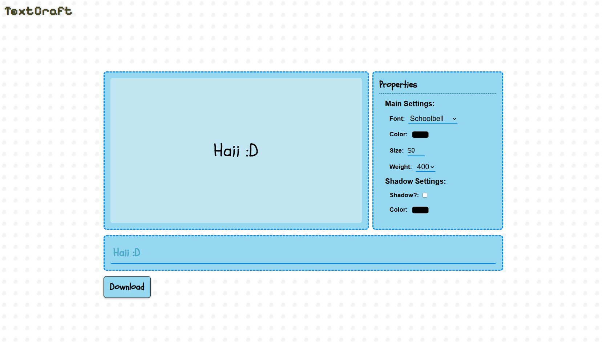
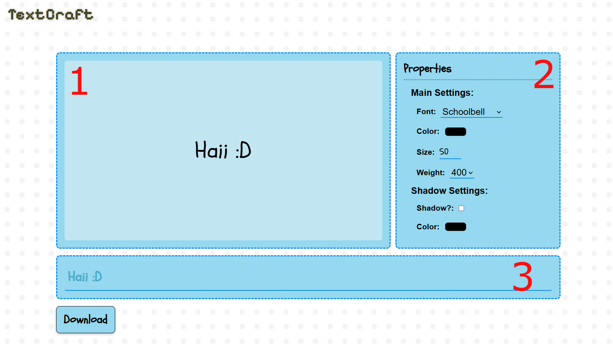

# TextCraft

**TextCraft** is a text styling app where you can costumize you text and just download a png of it!

You can try TextCraft [here](https://brundevcoder.github.io/TextCraft/)

Although TextCraft ins't a super advances editor, it's quite possible that new fonts and new ways to costumize text will be added in the future

## How does it work?

When you open the website, you see 3 tables: the largest displays the configuration results (1), another is the properties window, where you can costumize (2) and the third is where you enter the text (3)

## How to run it locally
You can just opem the `index.html` file, or you can also download the live server extension in Vs Code to try it out!